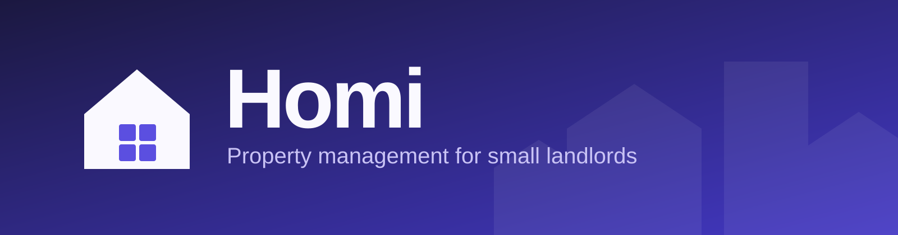
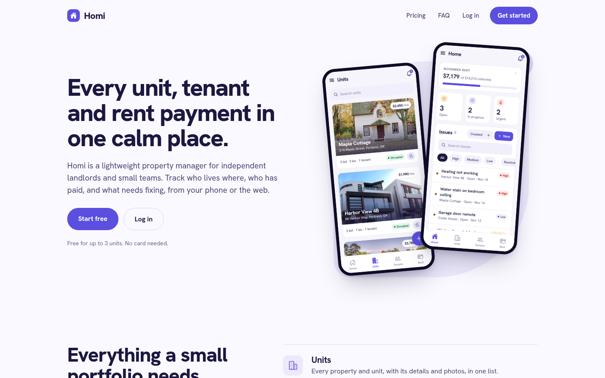
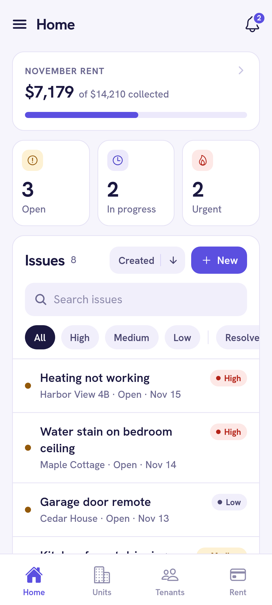
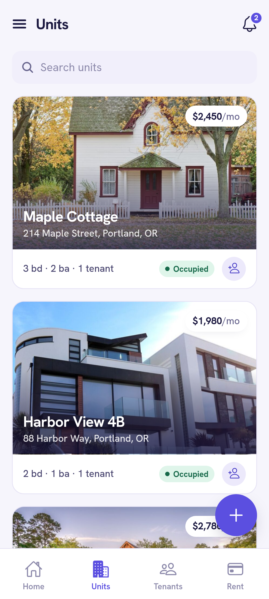
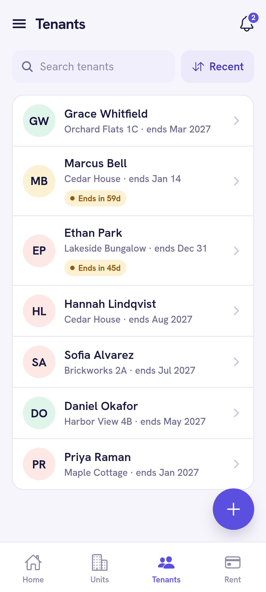
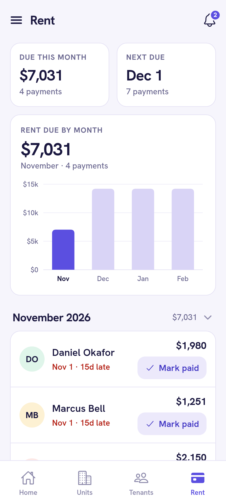
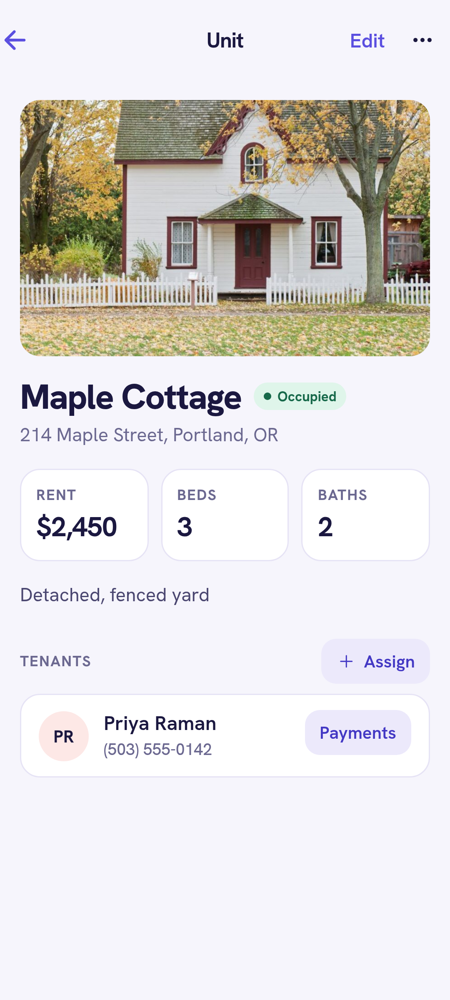
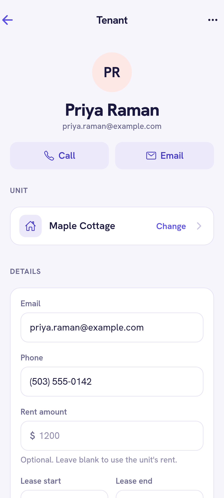
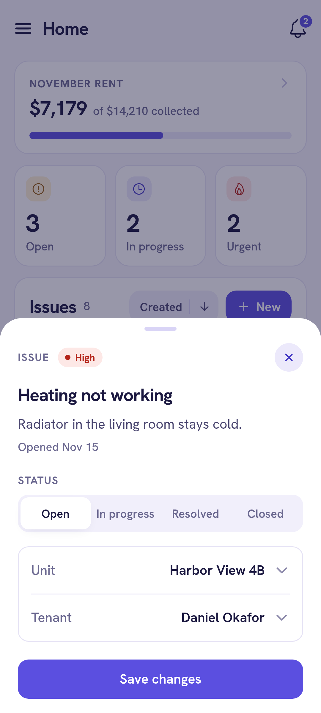
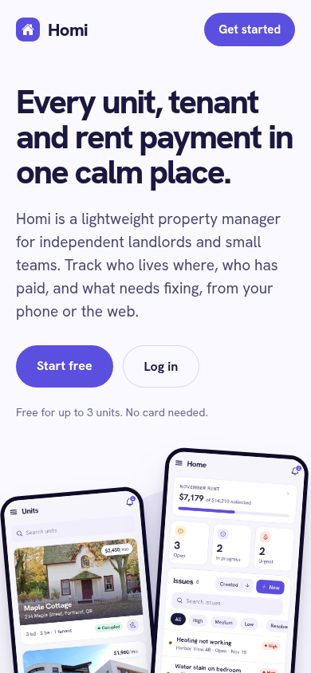

<p align="center">
  
</p>

<p align="center">
  
  
  
</p>

**Homi** is an open-source property management app for independent landlords and
small teams. It keeps units, tenants, rent and maintenance issues in one place,
on iOS, Android and the web, backed by a Rails API with background jobs,
organization-scoped data and photo storage. It tracks rent; it does not collect
payments.

<p align="center">
  
</p>

### At a glance

| | |
|---|---|
| **What it is** | A cross-platform client (one Expo codebase for iOS, Android and web) talking to a versioned REST API, with a public landing page in the web build. |
| **Stack** | Expo / React Native · Expo Router · React Query · Rails 8 API on Ruby 3.4 · Postgres · Sidekiq and Redis · Supabase Storage · Clerk. |
| **Quality** | 57 RSpec examples on the Rails API (request and service specs), 23 Vitest tests on the Node backend, OpenAPI docs generated with Rswag. No CI is configured yet. |
| **Interesting problems** | Per-organization data scoping from a third-party identity provider, generated rent schedules that stay topped up, photo upload and replacement through object storage, and a demo mode that runs the whole UI with no backend. |

### Engineering highlights

- **Authentication before controllers.** Rack middleware
  ([`clerk_authenticator.rb`](backend/backend-ruby/app/middleware/clerk_authenticator.rb))
  rejects requests without a valid Clerk token. Verification sits behind
  `AuthTokenVerifier`, so tests can stub it, and `OrgResolver` maps the Clerk
  organization to a local org so every query is scoped to it.
- **A documented, versioned API.** Controllers live under `api/v1`, request specs
  generate the OpenAPI document with Rswag, and Swagger UI is served at `/docs`.
- **Rent schedules that maintain themselves.** `Payments::ScheduleGenerator` builds
  due dates for a lease, and a top-up job keeps payments created 90 days ahead
  (`rake payments:top_up_future`).
- **Background work is isolated.** Sidekiq jobs in `app/jobs` hand off to service
  objects, such as the Expo push client in `app/services/push_notifications`.
- **Storage behind a service.** `SupabaseStorage` wraps upload, replacement and
  deletion of unit photos, so controllers never talk to Supabase directly.
- **One API module on the client.** Every screen fetches through
  [`frontend/lib/api.ts`](frontend/lib/api.ts) with central
  [query keys](frontend/lib/queryKeys.ts), which is also what makes demo mode a
  two-file switch rather than a rewrite.
- **A second backend.** [`backend/backend-node`](backend/backend-node) is a
  Fastify, BullMQ and Zod implementation of the same API, kept as an optional
  alternative.

> **Status.** Working and in active development. The rent reminder job currently
> only logs the payments due in three days; delivering those as push
> notifications is not wired up yet. Push registration is mobile-only. There is
> no CI and the app has no front-end tests. The screenshots below use seeded demo
> data (see [Demo mode](#demo-mode)), not a real portfolio.

## Contents

- [Features](#features)
- [Screenshots](#screenshots)
- [Quick start](#quick-start)
- [Demo mode](#demo-mode)
- [API](#api)
- [Architecture](#architecture)
- [Development](#development)
- [Credits](#credits)
- [License](#license)

## Features

**Units**
- Properties with address, beds, baths, monthly rent and notes.
- A cover photo per unit, uploaded to Supabase Storage. Replace or remove it any
  time.
- Occupied and vacant badges, and the rent shown on the photo.

**Tenants**
- Residents with contact details and lease dates, assigned to a unit.
- Search and sort by name, lease start, lease end or recently added, with leases ending soon flagged.
- Tap to call or email, change the unit, or edit the lease.

**Rent**
- A monthly overview of what is due, with a bar chart of rent due per month and overdue payments flagged.
- Payments are generated from the lease. Mark one paid with the method and a note.
- Per-tenant payment history from the tenant and unit pages.

**Maintenance issues**
- Log issues against a unit and tenant, with severity and status.
- Filter by severity and status, search by title, sort, and move an issue from
  open through to resolved.
- Home shows a rent-collected meter and open, in-progress and urgent tiles that double as filters.

**Notifications**
- An in-app inbox with unread badges, and Expo push notifications on mobile.

**Accounts and teams**
- Sign-up, verification and sign-in through Clerk. Data is scoped per
  organization. Light theme only for now.

Not in scope: collecting payments, tenant-facing portals, accounting exports,
and lease document storage.

## Screenshots

<table>
  <tr>
    <td width="25%"><br><sub><b>Home</b>: issue overview, filters and search.</sub></td>
    <td width="25%"><br><sub><b>Units</b>: photo cards with the key numbers.</sub></td>
    <td width="25%"><br><sub><b>Tenants</b>: leases at a glance.</sub></td>
    <td width="25%"><br><sub><b>Rent</b>: due payments by month.</sub></td>
  </tr>
  <tr>
    <td width="25%"><br><sub><b>Unit</b>: photo, details, tenants.</sub></td>
    <td width="25%"><br><sub><b>Tenant</b>: contact and lease.</sub></td>
    <td width="25%"><br><sub><b>Issue</b>: status, unit and tenant.</sub></td>
    <td width="25%"><br><sub><b>Landing page</b>: responsive sizing.</sub></td>
  </tr>
</table>

<sub>Screenshots are rendered from the real UI in demo mode with seeded data. Unit photos are from Pexels.</sub>

The full web landing page is in [`docs/images/landing-full.png`](docs/images/landing-full.png);
its code lives in `frontend/components/marketing/`.

## Quick start

You need Docker (for the API, Postgres and Redis), Node 20+ and a
[Clerk](https://clerk.com) application and [Supabase](https://supabase.com)
project for auth and photo storage. To try the UI with none of that, skip to
[Demo mode](#demo-mode).

### 1. Configure environment variables

Create an environment file for the Rails API (used by Docker) at `backend/backend-ruby/.env.local`:

```bash
# Rails / API
RAILS_ENV=development

# Database (either provide DATABASE_URL or these PG* vars)
DATABASE_URL=
PGHOST=db
PGPORT=5432
PGUSER=postgres
PGPASSWORD=postgres

# Auth (Clerk)
CLERK_SECRET_KEY=
CLERK_ISSUER=
# Optional
CLERK_AUDIENCE=

# Redis / Sidekiq
REDIS_URL=redis://redis:6379/0

# Supabase Storage
SUPABASE_URL=
SUPABASE_SERVICE_ROLE_KEY=
SUPABASE_STORAGE_BUCKET_UNITS=unit-media
SUPABASE_STORAGE_BUCKET_TENANTS=tenant-media

# Protect Sidekiq Web UI (optional)
SIDEKIQ_USER=
SIDEKIQ_PASSWORD=
```

If you plan to run the optional Node backend, create `backend/backend-node/.env.local`:

```bash
# Server
PORT=3001

# Auth (Clerk)
CLERK_SECRET_KEY=
CLERK_ISSUER=
# Optional
CLERK_JWT_ISSUER=
CLERK_ISSUER_URL=
CLERK_AUTHORIZED_PARTIES=

# Supabase Storage
SUPABASE_URL=
SUPABASE_SERVICE_ROLE_KEY=
SUPABASE_STORAGE_BUCKET_UNITS=unit-media
SUPABASE_STORAGE_BUCKET_TENANTS=tenant-media

# Redis for BullMQ
REDIS_URL=redis://localhost:6379/0

# Optional seed
ENABLE_SEED=false
```

Configure the frontend API URL and Clerk publishable key in `frontend/app.json` (under `expo.extra`):

```json
{
  "expo": {
    "extra": {
      "API_URL": "http://localhost:3000/",
      "CLERK_PUBLISHABLE_KEY": "pk_test_..."
    }
  }
}
```

### 2. Run the API (Rails, Docker)

```bash
cd backend/backend-ruby
docker compose build
docker compose up
```

- API available at `http://localhost:3000`
- Swagger docs at `http://localhost:3000/docs`

### 3. Run the app (Expo)

```bash
cd frontend
npm install
npm run start
```

### 4. Optional: run the Node backend

```bash
cd backend/backend-node
npm install
npm run dev
```

## Demo mode

To run the app with seeded sample data and no Clerk session or API:

```bash
cd frontend
npm install
EXPO_PUBLIC_DEMO=1 npx expo start --web
```

This swaps the API layer for an in-memory dataset
([`frontend/lib/demo.ts`](frontend/lib/demo.ts)) and reports a signed-in user
([`frontend/lib/auth.ts`](frontend/lib/auth.ts)). It is how every screenshot in
this README was made. Mutations such as marking rent paid work against the
in-memory data and reset on reload.

## API

All routes are under `/api/v1` and need a Clerk bearer token. Interactive docs
are at `/docs` when the server is running.

| Resource | Routes |
|---|---|
| Units | `GET/POST /units`, `GET/PUT/DELETE /units/:id`, `POST/DELETE /units/:id/image` |
| Tenants | `GET/POST /tenants`, `GET/PUT/DELETE /tenants/:id` |
| Payments | `GET/POST /payments`, `GET/PUT/DELETE /payments/:id`, `POST /payments/:id/pay` |
| Issues | `GET/POST /issues`, `GET/PUT/PATCH/DELETE /issues/:id` |
| Notifications | `GET/POST /notifications`, `PATCH /notifications/:id/read`, `PATCH /notifications/read_all` |
| Devices | `POST /device_tokens`, `DELETE /device_tokens/:token` |
| Other | `GET /me`, `GET /metrics/rent_summary`, `GET /api/healthz` |

## Architecture

```text
Expo app (iOS / Android / web)
        |  HTTPS + Clerk JWT
        v
Rails API  --->  Postgres
   |  \
   |   +--->  Sidekiq (Redis): rent reminders, schedule top-up, push delivery
   +--------->  Supabase Storage: unit and tenant photos
```

```text
frontend/
  app/                Expo Router screens: (tabs), units, tenants, rent,
                      notifications, settings, (auth), (marketing)
  components/         shared UI, plus marketing/ for the landing page
  lib/                api.ts, queryKeys.ts, types.ts, auth.ts and demo.ts
backend/
  backend-ruby/       Rails 8 API: controllers/v1, models, services, jobs,
                      middleware (Clerk), specs, Docker setup
  backend-node/       optional Fastify + BullMQ implementation with Vitest tests
docs/images/          banner and screenshots used by this README
```

The Clerk token is verified in middleware before a request reaches a controller.
A controller concern then resolves the organization from the token's org claim (or an
`X-Organization-Id` header) and scopes every query to it, so one organization can never
read another's units, tenants or payments.

Rent schedules are generated from the lease, and a scheduled job keeps payments
created up to 90 days ahead. Reminders and push delivery run as Sidekiq jobs, with
delivery handled by an Expo client in a service object.

## Development

```bash
# Rails API
cd backend/backend-ruby
docker compose run --rm api bundle exec rspec

# Node backend
cd backend/backend-node
npm test

# Front end
cd frontend
npm run lint
npx tsc --noEmit
```

`tsc` currently reports a handful of type errors that predate the demo-mode work
(in the sign-up and verify screens, `home.tsx` and `MinimalLineChart`).

## Credits

Unit photos in demo mode are from [Pexels](https://www.pexels.com) and used under
the Pexels license (see [`frontend/assets/demo/README.md`](frontend/assets/demo/README.md)).

## License

GPL-3.0; see [`LICENSE`](LICENSE).
